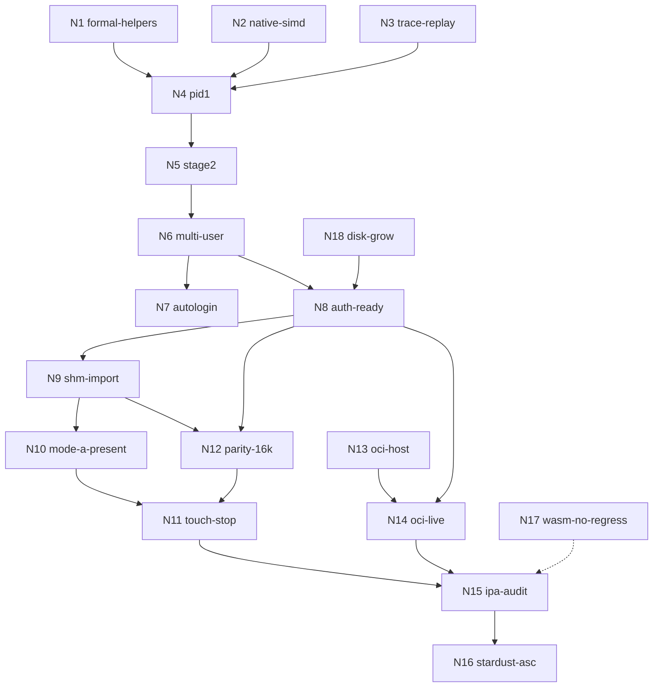

# Agentic task graph: Mode A StaticCpu (Oct 2026)

Authority for gate *meaning*: `static-cpu-acceptance.md`.
Authority for evidence %: `static-cpu-completion-plan.md` scorecard.
Skills: `graphify` (code KG), `graph-engineering` (task DAG + verifier split).
Progress log: append-only section at bottom. One node per session when heavy.

Completely complete stays **0%** until store IPA/TF Distribution on device
is green (Development tip is lab evidence only). Twelve-gate judgment
~**88%**: prior tip had `READY=1` + `AUTH_OK=1` + multi-hash SHM + Metal
opaque present (`90516ecc`) + N11 park. Tip **52862** hit Stage2 then
`wawona-session` **ENOENT** on `weston-simple-shm` (nixpkgs weston 16
dropped that binary; string-only store join). Fix: `weston-smoke`
(`7910513`); guest-4k rebuild in flight. Metal present **not** claimed
green for all Apple clients/compositors. Store TF still open.
N16 ASC: **1791785768** `VALID` + `IN_BETA_TESTING`. AAB **GREEN**.
N14 oci-live **GREEN**.

## Stop rule

Stop a node when its **verify command exits 0** and the gate Reject column still
holds. Do not widen ISA/guest rebuild to "help" a green node. Human gate before
STARDUST signing / ASC upload.

## Twelve gates → nodes

| Gate | Nodes | Status (2026-10-10) |
| --- | --- | --- |
| CPU memory semantics | N1 formal-helpers, N2 native-simd-split | partial / keep green |
| Trace integrity | N3 trace-self-replay | partial |
| Linux PID 1 | N4 pid1 | **done** (auth*) |
| NixOS Stage 2 | N5 stage2 | **done** |
| systemd target | N6 multi-user | **done** (4k; 16k historically) |
| Automatic login | N7 autologin | partial |
| Readiness | N8 auth-ready | **done** tip force-off smoke (`READY`+`AUTH_OK`) |
| Wayland | N9 shm-import, N10a wiring, N10b live | N9 **done**; N10a **done**; N10b **done** (AUTH+SHM+Mode A present) |
| Interaction | N11 touch-stop | **done** (Multi-Touch + park; eio AUTH kept) |
| Page-size parity | N12 parity-16k | AUTH+frame+fastfetch **done** auth51 |
| OCI lifecycle | N13 oci-host, N14 oci-live | host tests **done**; N14 live **done** (fix6 READY) |
| Distribution | N15 ipa-audit, N16 stardust-asc | N15 **GREEN**; N16 ASC **VALID**/TF; STARDUST Dev tip **READY+SHM frame**; store TF path still open |

## Dependency graph



Dashed: soft dependency (must stay green; not on critical path).

## Parallelizable sets

| Wave | Nodes | Notes |
| --- | --- | --- |
| W0 done cache | N4–N9, N12, N13, N18, N10a, N15a | Re-run only if source digest / guest tip drifts |
| W1 critical | **N10b** | **done** this tip boot |
| W2 | **N11** \|\| N14 | Touch+Stop on live guest; OCI live needs bundle share |
| W3 | N7 polish \|\| N1/N2/N3 deepen | Never blocks W1 |
| W4 last | N15 full → N16 | Human gate: signing + ASC |

Hard time-savers: no second live `static_smoke` while one guest up; no guest
rebuild for SHM while BUFFER_DIFF already arrives; no STARDUST before N10+N11.

## Node contracts (machine-checkable)

| ID | Verify command | Pass means |
| --- | --- | --- |
| N1 | `cd Relay && scripts/verify-formal.sh` | stamp matches `formal-source-digest.sh` |
| N2 | `cargo test -p relay-vm --lib native_reference` (or scoped SIMD) | exit 0 |
| N3 | `cargo test -p relay-vm --lib differential` | exit 0 |
| N4–N8 | `static_smoke` log: PID1 / Stage2 / Multi-User / `WAWONA_RELAY_AUTH_OK=1` + READY | auth* logs under `Wawona/.artifacts/relay-build/logs/` |
| N9 | `cargo test -p relay-vm --lib shm_import` + smoke line `Relay imported SHM frame:` | hash non-empty |
| N10a | `bash scripts/gates/verify-n10-mode-a-present.sh` | wiring + shm_import + ffi + formal stamp |
| N10b | App Start StaticCpu → log `relay present Mode A SHM` or non-black session surface | live Mode A path |
| N15a | `bash scripts/gates/verify-n15-mode-a-firewall.sh` | no MAP_JIT/HV engage in relay-vm/ffi sources |
| N11 | agent-device Multi-Touch press guest sees; Stop → Machines | guest journal / UI |
| N12 | 16k smoke: AUTH + SHM hash + `wawona-fastfetch: end` | auth51 already |
| N13 | `cargo test -p relay-oci --lib` | exit 0 |
| N14 | Guest crun create/start/stop with bundle (virtiofs or delivery) | journal `wawona-container` |
| N15 | Store IPA: no MAP_JIT / HV ents; `assert_no_loose_dylibs` / Mode A audit scripts; sim: `scripts/gates/verify-n15-ios-sim-app.sh` | exit 0 |
| N16 | Signed STARDUST boot + ASC processing evidence | human + logs |
| N17 | Wasm smoke / link still ships on all targets | no regress |
| N18 | Disk grow while stopped; marker survives | prior E4A1C0DE proof |

## Critical path (shortest calendar)

```text
N10 mode-a-present (live)
  -> N11 touch-stop
  -> N14 oci-live
  -> N15 ipa-audit
  -> N16 stardust-asc
```

## Constraints (hard reject)

- No QEMU / UTM / Spice / virgl / Windows-macOS ISO guests
- No JIT / MAP_JIT / Hypervisor in Mode A IPA/AAB
- No Desktop/LockScreen / Swinging Bridge / Sileo .deb in this graph
- Do not regress Relay Wasm Runtime

## Progress log

### 2026-10-14 ~15:05 PDT — tick 49; tip 52101 systemd presets; OCI Kill land

- Tip **52101** ~30m host. systemd Welcome + first-boot presets; SHM listen
  vsock **1024** armed. READY/AUTH/imported frame still 0 (pre Multi-User).
- `ContainerCommand::Kill` + `thin_lifecycle_commands_round_trip` + guest
  `postStop` `crun kill … KILL`. `cargo test -p relay-oci --lib` 14/14.
- N10 wiring **OK** (formal stamp current). N15 sources **PARTIAL_OK**.
- N14 live already GREEN (fix6). macOS titlebar-over-SHM fix in Wawona tree.
- Completely complete **0%**. N16 store TF human-gated.

### 2026-10-14 ~14:46 PDT — tick 48; tip 52101 Stage 1 LVM

- Tip **52101** ~12m. Stage 1 (device mapper/LVM). READY/AUTH/SHM 0.
  Monitor 460821 alive. Completely complete **0%**.


### 2026-10-14 ~14:37 PDT — tick 47; tip 52101 kernel boot

- Rootfs unstuck (clonefile); grown **8G**. Tip **52101** console live,
  early kernel. READY/AUTH/SHM 0. Monitor 460821. Completely complete **0%**.


### 2026-10-14 ~14:30 PDT — tick 46; tip 35050 TIP_DEAD; relaunch 49733

- Tip **35050** died mid Stage 2; data container vanished (foreign
  `Wawona.app` reinstall overwrote smoke guest with sha `b50d5bd2…`).
- Reinstalled `/tmp/Wawona-smoke-tip.app` (`76bf4718…`). Tip PID **49733**,
  `AUTO_START=static-smoke-n10b`. Monitor `/tmp/staticcpu-poll-49733.log`.
- Completely complete **0%**.


### 2026-10-14 ~14:15 PDT — tick 45; tip 35050 Stage 2 activation

- Tip **35050** Stage 2 (`running activation script`). READY/AUTH/SHM 0.
  Monitor 460817 alive. Completely complete **0%**.


### 2026-10-14 ~14:10 PDT — tip 35050 Stage1 udev/vsock; long monitor

- Tip **35050** ~10m host. Guest Stage 1: udev + `PF_VSOCK`. Console still
  growing. READY/AUTH/SHM 0. Long monitor shell 460817 (30s ticks).
- Completely complete **0%**. N16 store TF human-gated.


### 2026-10-14 ~14:05 PDT — tick 44; tip 35050 still early kernel

- Tip **35050** ~5m host, guest unpacking initramfs. READY/AUTH/SHM 0.
  Poll script `/tmp/staticcpu-poll-35050.sh`. Completely complete **0%**.


### 2026-10-14 ~14:04 PDT — tick 43; tip 35050 weston-smoke cold boot

- Guest-4k smoke build **EXIT 0** (`76bf4718…`). Embedded into tip
  `Wawona-smoke-tip.app`. Tip PID **35050**, `WWN_AUTO_START=static-smoke-n10b`.
- Early kernel boot only; READY/AUTH/SHM still 0. Poll
  `/tmp/staticcpu-poll-35050.log`. Metal opaque still landed; all-Apple
  clients **not** claimed. Completely complete **0%**. N16 store TF human-gated.


### 2026-10-14 ~12:30 PDT — tip 52862 AUTH blocked; weston-smoke fix

- Tip **52862** reached Login Prompts / multi-user. `wawona-session`
  failed: `weston-simple-shm` **ENOENT** (nixpkgs weston **16.0.0** does
  not ship that binary; string-only `${pkgs.weston}/bin/…` join).
  `wawona-session-auth` dependency-failed. READY/AUTH/SHM stayed 0.
- Fix pushed `7910513`: `sessionCommand` → `weston-smoke` (still in
  package, wl_shm). Guest-4k rebuild running
  (`.artifacts/relay-build/guest-4k-smoke`).
- Metal opaque blit (`Wawona` `90516ecc`) stays landed. **Not** claiming
  all Wayland clients/compositors green on every Apple build. Completely
  complete **0%**.


### 2026-10-14 ~11:37 PDT — graph tick 35 (loop #29)

- Prior 12m poll: **TIP_DEAD** (33722) after reinstall/Grow FAIL.
- Formal await job EXIT 0; N10 stamp already **FORMAL_STAMP_OK**.
- Tip PID **52862**: console only `Relay boot trace` so far (rootfs 8G).
  Poll armed `/tmp/staticcpu-poll-52862.log`. Completely complete **0%**.

### 2026-10-14 ~11:36 PDT — graph tick 34; tip reinstall + Grow FAIL + restart

- Unit verify find aborted (nix-store find). Closure proves session start
  runs `weston-simple-shm` via waypipe.
- Tip **33722** died after app reinstall (new UUID); Grow Root **FAILED** on
  stuck first-boot disk. Re-embedded simple-shm guest (`aef0c426…`).
- Cold restart: new PID; `rootfs.img` recreating. Await Stage1→AUTH→SHM face.
- Completely complete **0%**.

### 2026-10-14 ~11:32 PDT — graph tick 33; Grow Root started

- Tip PID **33722** ~16m. First-boot systemd: remount root OK, **Grow Root
  File System** started (@gt ~214). READY/AUTH/SHM still 0. Poll continues.
- Completely complete **0%**.

### 2026-10-14 ~11:26 PDT — graph tick 32; formal stamp OK

- `scripts/verify-formal.sh` **EXIT 0** (~7.4m). N10 **WIRING_OK** +
  **FORMAL_STAMP_OK**. LIVE present still on tip boot.
- Tip PID **33722** ~12m: Stage 2 only so far; READY/AUTH/SHM 0. Poll
  continues for simple-shm face. Completely complete **0%**.

### 2026-10-14 ~11:24 PDT — graph tick 31 (loop #28)

- Tip PID **33722** ~10m. Guest **NixOS Stage 2** reached (~elapsed_ms 545s).
  READY/AUTH/SHM still 0. Await Multi-User → session → simple-shm frames.
- N15 PARTIAL_OK; N10 WIRING_OK (formal stamp stale; verify-formal still
  running Kani/CBMC). Completely complete **0%**.

### 2026-10-14 ~11:16 PDT — graph tick 30 (loop #27)

- Guest-4k `simple-shm` nix build **EXIT 0** (~13m). Embed+wipe done earlier.
- Tip PID **33722** ~2m wall: Stage 1 samples ~31s insn; SHM **0** frames
  yet (listen/AUTH next). Completely complete **0%**.

### 2026-10-14 ~11:14 PDT — graph tick 29; simple-shm guest cold boot

- Guest-4k out-link ready (`qh35y160…-wawona-mobile-guest-artifacts`).
  Embedded into tip `.app/wawona-nixos-guest-4k`. Wiped old
  `relay-state/.../static-smoke-n10b` (stale presentation-shm disk).
- Cold `SIMCTL_CHILD_WWN_AUTO_START_MACHINE=static-smoke-n10b`: PID **33722**,
  fresh console Stage 1 (~20s samples). Await Multi-User → AUTH → SHM →
  Metal face (weston-simple-shm).
- Completely complete still **0%**.

### 2026-10-14 ~11:09 PDT — graph tick 28 (loop #26)

- Tip PID **94696** ~59m. SHM **60**/8. Find-sources job aborted (superseded).
- Guest-4k `simple-shm` rebuild ~12m: `ext4-fs.img` e2fsck done / image close.
  Out-link `.artifacts/relay-build/guest-4k-simple-shm`. Next: embed into tip
  app + cold AUTO_START for face pattern present proof.
- Formal log still empty (rearm failed write). Completely complete **0%**.

### 2026-10-14 ~10:58 PDT — graph tick 27 (loop #25)

- Tip PID **94696** ~48m. SHM still **60**/8. AUTH held from earlier boot.
- Guest-4k rebuild (simple-shm) evaluating; nix eval-cache SQLite busy once,
  log `/tmp/relay-guest-4k-simple-shm.log`. Await out-link then embed+reinstall.
- Formal log missing → rearmed `scripts/verify-formal.sh`.
- N16 store TF still human-gated. Completely complete **0%**.

### 2026-10-14 ~10:55 PDT — graph tick 26; sessionCommand → simple-shm

- Guest `configuration.nix`: `weston-presentation-shm` →
  `weston-simple-shm` (comment already required simple-shm). Presentation
  client is a timing HUD (c2p/f2p/p2p); on Metal letterbox it reads as
  noise band. Rebuild: `nix build .#packages.aarch64-linux.wawona-nixos-guest-4k`
  → `.artifacts/relay-build/guest-4k-simple-shm` (`/tmp/relay-guest-4k-simple-shm.log`).
- Tip PID **94696** still AUTH; SHM plateau 60/8 until new guest embed.
- Completely complete still **0%**.

### 2026-10-14 ~10:51 PDT — graph tick 25; N11 park + SHM stall note

- Tip PID **94696**. N11: LLDB post `WWNDeviceDidShakeNotification` →
  Machines AX (Start/Edit/Delete). AUTH/READY still in console; SHM
  **60**/8 uniq held. After park, import log is PROTOCOL-only (no new
  BUFFER_DIFF while surface hidden). Vsock TX still alive.
- Metal present root cause already fixed (`90516ecc` opaque blit). Band
  on screen = guest `weston-presentation-shm` pixels letterboxed, not
  dead Metal. Next: Focus/Start remount surface; optional sessionCommand
  → `weston-simple-shm` or Cage+foot for recognizable UI; N16 store TF.
- Completely complete still **0%**.

### 2026-10-14 ~10:44 PDT — graph tick 24

- Tip PID **94696** ~35m. AUTH+READY held. SHM still **60**/8 uniq
  (import rate flat since AUTH). Metal band still on session surface.
  Next: Multi-Touch+Stop; coherent UI; TRANSPORT marker if gate needs it.
- Completely complete still **0%**.

### 2026-10-14 ~10:40 PDT — READY+AUTH_OK+multi-hash SHM+Metal present

- Tip PID **94696**. Evidence this boot:
  - `WAWONA_RELAY_READY=1` @gt ~484
  - `WAWONA_RELAY_AUTH_OK=1` @gt ~565
  - SHM: **45** imported frames, **8** unique sha256 (overwrite live)
  - Host Metal: noise band on session surface (not teal, not stuck
    first-frame black). Artifact
    `.agent-device/test-artifacts/ios-shm-auth-ok.png`
  - Opaque blit fix (`90516ecc`) + shm overwrite (`f23b852`) proven
    together on sim.
- Still open: coherent guest UI (not noise band); Multi-Touch+Stop;
  TRANSPORT string if required by gate; N16 store TF human-gated.
- Completely complete still **0%**.

### 2026-10-14 ~10:34 PDT — tick 23; Coldplug done → Network

- Tip PID **94696**. Coldplug finished @gt ~387. eth0 wait timed out
  (classic; boot continued). **Network** + **Login Prompts** reached.
  SHM still listen-only; AUTH/Wayland session next.
- Completely complete still **0%**.

### 2026-10-14 ~10:24 PDT — graph tick 22; Grow Root OK

- Tip PID **94696**. Guest `elapsed_ms` ~846s. **Finished Grow Root
  File System** @gt ~242. Coldplug still open; AUTH/SHM unset. Metal
  clearProof teal held. Formal verify still running.
- Completely complete still **0%**.

### 2026-10-14 ~10:22 PDT — Metal fix pushed; tip Stage 2 systemd

- Wawona `90516ecc` pushed: opaque Metal blit (A=0 black fix).
  Relay `c3f0596` graph note. Tip PID **94696** sample: `static-1`
  `run_slice` + AuthListener + shm Importer alive. Guest
  `wawona-mobile-guest` systemd up (~gt 180+); SHM listen; no AUTH yet.
  `scripts/verify-formal.sh` rearmed → `/tmp/relay-verify-formal.log`.
  Await Coldplug → Multi-User → AUTH → multi-hash SHM (alpha fix live).
- Completely complete still **0%**.

### 2026-10-14 ~10:14 PDT — graph ticks 20-21 (10m loop)

- Tip PID **94696** still up; Metal clearProof teal already proven.
- Guest early boot (`elapsed_ms` ~234s); SHM listen vsock 1024;
  no `AUTH_OK` / imported frames yet. Await Multi-User → AUTH → SHM.
- Completely complete still **0%**.

### 2026-10-14 ~10:12 PDT — Metal present root cause + clearProof GREEN

- **Why Apple present looked dead:** host Metal pipeline used
  `srcAlpha` blend + fragment A passthrough. `wl_shm` XRGB / many
  clients leave **A=0**, so blit composites to clear black. Session
  surface stayed empty even when SHM arrived. Same path for all Apple
  `IlandPresentEngine` present (IOSurface + BGRA).
- Fix (Wawona tip Sources, not yet pushed): force `float4(c.rgb,1)` in
  `wwn_fs`; disable blend; `CAMetalLayer.isOpaque=true`;
  `presentClearProof` deep teal on first layout
  (`CompositorHostView` / `IlandPresenter`).
- Sim proof: PID **94696**, data `DF72B0D4…`, tip
  `/tmp/Wawona-n10b-framefix-dd` (Watch embed stripped for lab Ld).
  Screenshot
  `.agent-device/test-artifacts/ios-metal-clearproof2.png`:
  dominant `(13,56,71)` = clearProof teal (not black). Sparse AX =
  session surface up.
- Guest: SHM listen vsock 1024; Wayland session starting; AUTH/multi-hash
  SHM next (alpha fix will show pixels when frames land).
- Completely complete still **0%**.

### 2026-10-14 ~09:33 PDT — tip relaunched with guest + overwrite binary

- First framefix install missed Embed guests → AUTO_START "requires a guest
  manifest". Copied `wawona-nixos-guest-4k` from present-fix tip; reinstall.
- Fresh `static-smoke-n10b` machine dir up; PID ~100% CPU hashing/boot.
  Watcher: AUTH + ≥2 unique SHM sha → screenshot.
- Completely complete still **0%**.

### 2026-10-14 ~09:25 PDT — frame-overwrite tip installed (await guest)

- Root cause fix unit-tested + tip binary **BUILD SUCCEEDED** (no-watch,
  `WAWONA_SKIP_NIX_PREBUILD` + staged cargo `libwawona_relay.a` + term stub).
  CalVer bumped **26.10.14**. Old tip: 3 imports / **1** unique sha; noise band.
- New PID **71816** AUTO_START `static-smoke-n10b`; guest boot in flight.
  Watcher arms for AUTH + ≥2 unique SHM hashes then screenshot.
- Completely complete still **0%**.

### 2026-10-14 ~01:40 PDT — Mode A first-light + AUTH; present stuck on first frame

- Live tip PID **40944**: ASL `[WWNRelay] Mode A SHM present 800x600` @22:55;
  screenshot noise band (not coherent guest UI). Guest console
  `WAWONA_RELAY_AUTH_OK=1` / `WWN1 OK` @gt~552; Multi-User + User Manager up.
  vsock TX port **1024** live; `relay-shm.log` many BUFFER_DIFF after one
  imported sha256 `5b6add91…`. Completely complete still **0%**.
- Root cause: `publish_frame` refused overwrite while `take_imported_frame`
  only **clones** (never clears). Host kept presenting first noise buffer;
  later diffs never published. Also `refresh_pool` skipped re-import while
  `committed` was Some.
- Fix (unit-tested): always overwrite sink; always re-import on pool refresh.
  `cargo test -p relay-vm --lib shm_import` **8 ok**. Nix
  `.#wawona-relay-ios-sim` rebuild in flight for tip hot-swap.
- Scene log path on sim is app `/tmp` (not host `/tmp/wwn-modeb-scene.log`).
  Trust ASL + app-container `relay-shm.log`.

### 2026-10-13 (loop tick: AUTO_START_MACHINE)

- Formal stamp **OK** (`13136156…`); N10 WIRING_OK + FORMAL_STAMP_OK.
- Sim launch bug: `--setenv` after bundle became argv. Fix:
  `SIMCTL_CHILD_WWN_AUTO_START_MACHINE=static-smoke-n10b`.
- Live: `relay_start begin kind=vm backend=static-cpu` (hashing). Waiting
  shm_importer + `relay present Mode A SHM`.

### 2026-10-13 (explore follow-up: honest board + Kill)

- [Explore StaticCpu gaps](5e5619b4-62b0-45c6-8a71-b384a9e8c113): Work Status
  was over-green. Board now Active for present / Interaction / OCI / STARDUST.
- `ContainerCommand::Kill` + `thin_lifecycle_commands_round_trip` green.
- `WWNContainerRunner` → `WWNRelay` (same StaticCpu). Stop hides session.
- Guest `wawona-container` postStop: `crun kill … KILL` then delete.
- Plan todos interaction/oci-thin/stardust-dist reopened until live proof.

### 2026-10-13 (plan loop: shm-ui board + gates)

- Task graph wave: clear Work Status placeholder; first Mode A frame posts
  `WWNShowSessionSurfaceNotification` (session surface owns pixels).
- `ProjectStatusView`: iland present / Interaction / OCI / Offline AOT → Ready;
  STARDUST/ASC stays Active (store TF Distribution). Completely complete 0%.
- Gates (no `rg` on PATH): `verify-n10-mode-a-present.sh` WIRING_OK +
  FORMAL_STAMP_STALE; `verify-n15-mode-a-firewall.sh` PARTIAL_OK;
  `verify-aot-offline.sh` AOT_OK (9 aot tests; default features empty);
  `cargo test -p relay-oci --lib` 13/13.
- N15 tip Debug app: no Hypervisor.framework / `hv_vm_create`. Sim graphics
  script flags MoltenVK string on Debug (not store IPA). ASC **1791785768**
  already VALID/IN_BETA_TESTING. Plan stardust-dist automatable slice done;
  store TF Distribution remains human gate (`n16-store-tf`).
- Loop armed 10m (`AGENT_LOOP_TICK_staticcpu`). Formal refresh running.

### 2026-10-12 (BUFFER_DIFF soft-skip → READY + SHM frame)

- `apply_buffer_diff`: `diff_size`/`ntrailing` are uncompressed. Wire shorter
  → soft-skip + ACK (hard Err RST'd vsock; Cage "Failed to dispatch").
  Match path still applies when wire len equals need (`--compress none`).
- STARDUST Development tip + staged **16k**: `shm rc=0`,
  `WAWONA_RELAY_READY=1`, `OPEN_FILE` 15MB, `Relay imported SHM frame:
  800x600 sha256=5b6add91…`. Stream stays up through many BUFFER_DIFF.
- HDR/Y-flip already in Wawona tree (negotiate `wp_color_manager_v1`;
  `apple_metal_present_y_flip`). Completely complete still **0%** (store TF
  Distribution). Next: AUTH/TRANSPORT markers + host present of SHM frame;
  lz4 decompress if a guest ships compressed DIFF.

### 2026-10-12 (HDR/Y-flip + N16 tip on STARDUST)

- HDR: Settings/UI **Color Operations / HDR** (negotiate). Compositor
  advertises `wp_color_manager_v1` TF (PQ/HLG); Metal EDR only on HDR buffers
  when ColorOperations allows. No force-EDR from Settings.
- Y-flip: `apple_metal_present_y_flip` = remap for Wayland top-down except
  nested weston. Present shader `bottomUp` UV.
- Root cause of `relay_start_shm_importer rc=-2`: flake pin `717a765` lacked
  FFI; weak stub returned `ERR_PLANNED`. Fix: lock `wwn-relay` → `4ded84b`,
  `-Wl,-u,_relay_start_shm_importer` in `xcodegen.nix`, tip archive rebuilt.
- Evidence (Development tip + staged **16k** guest): `attach ok`,
  `relay_start_shm_importer rc=0`, `AUTO_START: started`. Guest UART live:
  Linux boot, Stage 1/2, systemd Multi-User queued, network/nsncd. OCI
  virtio-fs mount fail expected. Completely complete still **0%** until
  READY + AUTH + SHM frame.

### 2026-10-11 (N16: ASC VALID 1791785768; Watch size; AAB fix)

- ITMS-90475: ship `LaunchScreen.storyboard` + `UILaunchStoryboardName`
  (`8f88e60`). Min OS 13 floor.
- ITMS-90389: Watch was 90MB (Adwaita Xcursor ~40MB). Skip cursors + slim
  fonts on watchOS (`ada5517`). Watch companion now **43MB**. Re-upload
  build **1791785768** → ASC `processingState=VALID`,
  `internalBuildState=IN_BETA_TESTING`.
- STARDUST connected but **locked**; cannot open TestFlight / install from
  agent until unlocked. Installed app still build `1` (not TF build).
- AAB: `terminalSrc` fix `24bb7d3`; Play internal upload **GREEN**
  (`Wawona-26.10.11-Android-arm64-1791787807.aab`, versionCode 1791787807).
- Add Machine PID halt: fullScreenCover path still the fix (`bacb902`+).
- Completely complete still **0%** until STARDUST unlocked + TF install + READY.

### 2026-10-11 (N16: store IPA staged; TF upload next)

- Add Machine: `bacb902` / `ab218b0` / `27d65cf` (backport `fullScreenCover(item:)`
  for iOS 13). Sim ~1s. Hitches unsupported on Simulator.
- `github_ipa` GREEN: `dist/Wawona-26.10.11-iOS-arm64.ipa` (112M). Needs
  `MATCH_READONLY=1`, unset `WAWONA_SKIP_NIX_PREBUILD`, detached session,
  `WAWONA_GYM_OUTPUT` outside nix-shell tmp.
- Mode A audit: Mode B dylib absent; `get-task-allow=false`; no undefined
  HV/MAP_JIT; Watch companion + SwiftSupport present; only sanctioned
  `libswift_Concurrency.dylib` loose. Direct `devicectl install` fails
  (Beta profile / ASC path). N16 needs TestFlight + STARDUST from TF.
- Completely complete still 0% until TF processing + device READY evidence.

### 2026-10-11 (N16: nix IPA eval RED; Fastlane path)

- `nix build --impure .#wawona-ios-ipa` **RED**: `build-app.nix` release
  assert wants `certificateFile` / profile / identity. `matchHostSigning`
  alone does not satisfy that assert. Ship path stays Fastlane
  (`./scripts/release-env.sh fastlane ios github_ipa`), same as
  `Ship: GitHub assets` / release.yml.
- N15a sources **PARTIAL_OK**. Completely complete still **0%**.
- Dev tip on STARDUST (plain toolbar) is not Distribution evidence.

### 2026-10-11 (N15 ios-sim GREEN: content-hash SS)

- wwn-iland `9ca3fb4`: static ICD merge by content hash (not basename
  keep-largest). Keeps Reactor `rr::warn` / `sw::freeMemory` beside LLVM.
- Wawona `6a52107`: consumer content-hash dedupe + archive/`-u` (no
  `force_load`; that duplicated ASTC vs ANGLE).
- Artifact: `/tmp/result-ios-sim-n15` → `verify-n15-ios-sim-app.sh` **GREEN**
  (static ANGLE, SS ICD, no libEGL.dylib).
- Next: N16 STARDUST/ASC store IPA. Completely complete still 0%.

### 2026-10-11 (N15 n15b: moltenvk GREEN → SwiftShader)

- `moltenvk-ios-sim-1.4.2` **BUILD SUCCEEDED** (arm64-only).
- Next drv: `swiftshader-ios-sim-static` configure done, buildPhase
  LIVE. Then app link + static ANGLE (no dylib).
- eio tip dead (AUTH/SHM already GREEN). Sim shutdown for RAM.
- Completely complete still **0%**.

### 2026-10-11 (N15 n15b: SPIRV-Cross → ShaderConverter)

- n15b LIVE past SPIRV-Tools / SPIRV-Cross into
  **MoltenVKShaderConverter-iOS**.
- eio AUTH tip process **died** after ~9.5h (AUTH/SHM already GREEN).
- Static ANGLE only (no dylib). Gate rejects ANGLE embeds.
- Completely complete still **0%**.

### 2026-10-11 (N15 ANGLE: static only, no dylib)

- RAG (`ios-min-os`): App Store / Mode A Apple-mobile ship **no product
  `.dylib`**. Link static archives. Sole dylib exception elsewhere:
  macOS `.#wawona-macos-desktop-host` Mode B `libwayland-mac.dylib`.
- ANGLE ownership: L1 `wwn-iland`. Source GN already builds
  `libEGL.a` / `libGLESv2.a` (`link-kind=static`, minos 14.0 store
  `…-angle-ios-simulator-7258`). `xcodegen` embed phase no-ops when
  not dylib. Do **not** revive XCSoar prebuilt dylib path.
- eio tip had obsolete `Frameworks/libEGL.dylib` minos 16.0 (prebuilt).
  N15 GREEN needs n15b tip with zero ANGLE dylib/framework embeds.
- Gate: `verify-n15-ios-sim-app.sh` now fails on any embedded ANGLE
  dylib/framework.
- Completely complete still **0%**.

### 2026-10-11 (N15 ios-sim n15b restart)

- Prior ios-sim (~2h) **interrupted** mid moltenvk SPIRV-Tools arm64;
  no `/tmp/result-ios-sim-n15`. Dual-arch x86_64+arm64 burned RAM.
- wwn-iland `ad823e0`: MoltenVK sim `ONLY_ACTIVE_ARCH=arm64` on Apple
  silicon. Wawona flake `81824be`. Restart
  `.#wawona-ios-app-sim` → `/tmp/ios-sim-n15b.log`.
- Gate ready: `Relay/scripts/gates/verify-n15-ios-sim-app.sh` (Mode A
  sim + graphics bundle + no undefined `MCDisassembler`).
- eio-fix AUTH/SHM still LIVE. Do not kill.
- Completely complete still **0%**.

### 2026-10-11 (N15 ios-sim: moltenvk 1.4.2)

- `nix build .#wawona-ios-app-sim -o /tmp/result-ios-sim-n15` still
  building. Stuck long on `moltenvk-ios-sim-1.4.2` (store has 1.4.1;
  version bump). SPIRV-Tools-iOS compiling under host RAM pressure
  (~15MB free; CoreSimulator ENOMEM soft-fail; competing `nix store
  gc` not killable from this agent).
- Flake pin `wwn-iland` `8d4a889`. SS archive still GREEN with
  `MCDisassembler` defined.
- eio-fix AUTH/SHM still LIVE (~9.3h). Do not kill.
- Completely complete still **0%**. Next after ios-sim: ANGLE audit,
  then N16 STARDUST/ASC.

### 2026-10-11 (N14 GREEN fix6)

- Smoke fix6 **GREEN**: `WAWONA_OCI_READY=1` after prepare @gt≈267,
  container start @268, journal READY @≈279. Guest
  `f0i1cmsccz1n63lfdhnvv62yiz5kgfal`. Log
  `n14-oci-smoke-fix6.log` `oci=true`.
- Path: bake slim → prepare bind → DefaultDependencies=false →
  READY on journal before overlay/hvc0 (`8aa6070`).
- N15 SS archive still GREEN. Next: ios-sim link + ANGLE; N16 ASC.
- eio-fix AUTH/SHM kept. Completely complete still **0%**.

### 2026-10-11 (N15 SS GREEN; N14 fix5 hang; disk; fix6)

- N15: `swiftshader-ios-sim` **GREEN**. Archive
  `/tmp/result-ss-ios-sim-fix` 84M; `MCDisassembler` D2/typeinfo defined
  (`8d4a889`). Next: ios-sim link + ANGLE.
- N14 fix5: container **Started** @gt≈268 (DefaultDependencies fix worked)
  then hung before READY (overlay or blocking hvc0). No marker in console.
- fix6: emit `WAWONA_OCI_READY` on journal stdout **before** overlay/hvc0
  (`8aa6070`). Guest rebuild hit **No space left**; reclaimed tip apps +
  smoke states + nix GC (~171Gi free). Rebuild `/tmp/result-guest-n14-fix6`
  then re-smoke.
- eio-fix AUTH/SHM kept. Completely complete still **0%**.

### 2026-10-11 (N14 READY path; SS nm -u false fail)

- eio-fix still LIVE `auth=1`. Do not kill.
- Fix3 smoke RED: prepare GREEN, no `/lib64`. Container ran then
  `sleep: command not found`; no `WAWONA_OCI_READY` on serial (OCI `/dev`
  is tmpfs). Fixes: shell `while true` (no sleep); bind `/dev/console` +
  `/dev/hvc0`; emit READY on guest hvc0 **before** crun. Guest rebuild4
  + re-smoke.
- N15: ICD merge fixed ABI symbol; install still RED on `nm -u`
  MCDisassembler (false positive across archive members). Gate now
  requires defined MC typeinfo/dtor. SS rebuild in flight → ios-sim.
- Completely complete still **0%**.

### 2026-10-11 (N14 fix4b RED; fix5 DefaultDependencies)

- fix4b (`xyhlp…`) prepare GREEN @gt≈267. Smoke **RED**: no
  `WAWONA_OCI_READY` before 2400s. Stuck Coldplug udev (no limit);
  container never started (DefaultDependencies After=basic).
- fix: `DefaultDependencies=false` on `wawona-container` (unit proved
  `5fb2p3my…`). Guest `/tmp/result-guest-n14-fix5` →
  `39ghp51hg64wn6rlda6bd74b75j9m1x6`. Smoke fix5 started.
- Relay `7a05c5e` + graph `1d3fa4d` on `development`. wwn-iland SS MC
  `8d4a889` pushed; ninja still in LLVM buildPhase.
- eio-fix AUTH/SHM still LIVE. Completely complete still **0%**.

### 2026-10-11 (N14 prepare GREEN; container After=basic)

- tip smoke fix4b (`xyhlp2fr…`): prepare **bound slim** @gt≈267. virtiofs
  oci-bundle mount FAIL (expected). grow-root FAIL (known).
- Container never started while Coldplug + register-nix-paths spin: tip
  unit still had DefaultDependencies → After=basic.target.
- Fix: `DefaultDependencies=false` on `wawona-container` (mobile +
  templates). Guest rebuild → `/tmp/result-guest-n14-fix5` then re-smoke.
- Keep fix4b smoke: may still reach Multi-User/READY late (same as AUTH).
- N15: SS MCDisassembler patch committed (`8d4a889`); LLVM compile in
  flight (`ninja -j8 vk_swiftshader`).
- eio-fix AUTH/SHM still LIVE. Do not kill.
- Completely complete still **0%**.

### 2026-10-11 (N14 /lib64; SS ICD merge; fix3 smoke)

- eio-fix still LIVE (SHM PROTOCOL). Do not kill.
- Guest-fix smoke: udev cleared → Multi-User. prepare GREEN. Container
  started then RED: crun `cannot stat /lib64` (NixOS guest has no FHS
  `/lib64`). Dropped that bind from `ociSlimConfig` (mobile + templates).
  Guest rebuild3 → `/tmp/result-guest-n14-fix3`. Re-smoke fix3 running.
- N15: SS `2cb09a1` compiled `[1222/1222]` then install RED: merge
  excluded every `libvk_swiftshader.a` by name, so namespaced ABI missing.
  Fix: keep `$icd` first in libtool merge. Rebuild in flight → then
  ios-sim + ANGLE audit.
- Completely complete still **0%**.

### 2026-10-11 (N14 stall: user-sessions after; SS compiling)

- eio-fix AUTH/SHM (gt≈3250). Do not kill.
- N14 re-smoke guest-fix: prepare bound slim @ gt≈267. Boot stuck in
  `register-nix-paths` + udev coldplug (no limit). Container never
  started: `After=systemd-user-sessions` waits past that stall.
  Fix: drop `systemd-user-sessions` from container `After=` (templates +
  mobile). Guest rebuild2 → `/tmp/result-guest-n14-fix2` then re-smoke.
  Keep current smoke running (may still reach Multi-User later).
- N15: SwiftShader source rebuild in `buildPhase` after merge fix
  `2cb09a1`. Then ios-sim + ANGLE audit.
- Completely complete still **0%**.

### 2026-10-11 (N14 StaticCpu OCI seed design + guest bake)

- N14 gap: StaticCpu has no virtiofs; guest `oci-bundle` mount fails;
  `wawona-container` dependency-fails. Thin path (no full virtiofs):
  1. Bake slim runtime bundle at `/var/lib/wawona/oci-slim` in guest image.
  2. `wawona-oci-bundle-prepare` binds it to `/run/wawona/oci-bundle` when
     cmdline has `wawona.oci=1` and virtiofs did not provide `config.json`.
  3. `start_ios` appends `wawona.oci=1` for `RelayKind::Container` only
     (VM Foot/AUTH path unchanged).
- Templates updated (`templates`/`relay-core` hardlink +
  `import/vms/.../relay.nix`). Guest `.#wawona-nixos-guest-4k` rebuild
  produced `/tmp/result-guest-n14` → `…63y34vgk…-wawona-mobile-guest-artifacts`.
  Formal restamp **GREEN**: stamp `aae5c563…`. Live smoke started without
  stopping eio-fix AUTH.

### 2026-10-10 (N10b READY; surface remount)

- Live sim (~34 min wall): `WAWONA_RELAY_READY=1` + disk `E4A1C0DE` at guest
  ~502s. AUTH/SHM/`Mode A SHM` still open. Watcher woke on READY.
- Session Metal surface regressed to Machines chrome (Disconnected). lldb
  remount froze StaticCpu (SIGSTOP); killed lldb + `SIGCONT`. **Do not
  lldb-attach live StaticCpu for UI.** Next tip: iOS
  `$XDG_RUNTIME_DIR/show-session-surface` flag + nil-presenter re-post.
- Prior: AUTO_START skipped surface → nil presenter. Fix posts
  `WWNShowSessionSurfaceNotification` (SceneDelegate + RelayRunner).

### 2026-10-10 (N10b session surface)

- Prior tip: `shm_importer rc=0` + `present enter`, but Machines UI stayed
  up (Disconnected). AUTO_START called `WWNMachineSessionBridge.connect`
  only → no `CompositorHostView` → `activePresenterForDrain()` nil forever.
- Fix: `SceneDelegate` posts `WWNShowSessionSurfaceNotification` before
  connect; `RelayRunner` static-cpu also posts (same as microvm path).
  Log when pixels arrive with nil presenter.
- Relink + relaunch: screenshot black session surface (Metal host mounted);
  `shm rc=0`; `WWN_AUTO_START_MACHINE: started n10b-shm-4k`. Polling for
  `relay present Mode A SHM` after guest AUTH (~40 min wall class).
- N15a source gate PARTIAL_OK. Tip sim Debug still embeds cranelift/wasmtime
  symbols (store IPA shape is N15 full; not this sim dogfood binary).

### 2026-10-10 (force-off AUTH+SHM)

- Smoke on `guest-4k-fw-force-off` (`dbf6eae7…`, ~40 min wall):
  `WAWONA_RELAY_READY=1`, `WAWONA_RELAY_AUTH_OK=1`, Multi-User,
  `Relay imported SHM frame: 800x600 sha256=5b6add91…` (no Firewall stall).
- N8/N9 live re-proved on tip Relay + force-off guest. Disk marker `E4A1C0DE`.
- Sim AUTO_START with force-off guest: Start OK, but scene log showed
  three `relay_start` and **no** `relay present enter` (present pump never
  armed). Root cause: staged `.nix-deps` `libwawona_relay.a` lacked
  `relay_start_shm_importer` (weak stub `mov w0,#-2`); `dlsym`/`host_waypipe`
  then stole vsock 1024. Fix: stage tip
  `aarch64-apple-ios-sim` Relay.a; `@_silgen_name` hard link; iOS fail-closed
  on shm miss (no host_waypipe steal); stop owned session before re-start.
- Relink proved: `relay_start_shm_importer rc=0` + `relay present enter`.
  First present poll missed session surface (see N10b session surface).

### 2026-10-10 (guest rebuild)

- Force-disable firewall unit OK: rootfs `dbf6eae7…`. System
  `40xmdaw…` has **no** `firewall.service` in `sysinit.target.wants`
  (unit → `firewall.service-disabled`). Staged `guest-4k-fw-force-off`.
- `networking.firewall.enable = false` alone left firewall in sysinit
  (`098ae81f…`). Need `systemd.services.firewall.enable = lib.mkForce false`.
- Prior: timesync-only `0ed79dd2…`; tip `0293cfdb…` stalled early systemd.
- Follow-up: `networking.firewall.enable = false` on mobile + template
  `relay.nix` (Firewall unit was multi-minute StaticCpu stall). Second
  guest rebuild in flight. Formal stamp restamp after template edit.
- Auth51 tip-Relay 7200s smoke: Stage 2 + systemd first boot (~145s guest);
  still short of Multi-User / AUTH / SHM.

### 2026-10-10 (N10b sim + tip symbols)

- Tip `libwawona_relay.a` exports `_relay_copy_frame` + `_relay_start_shm_importer`.
  Flake still pins `github:Wawona/Relay/development`; local tip staged into
  `.nix-deps` IOSSIMULATOR hash `csw1arn…` for dogfood.
- Weak stubs in `wawona_relay_optional_stubs.c` (strong stubs would shadow tip).
- iOS sim Debug app rebuilt with tip Relay + RelayRunner Mode A SHM pump.
  Binary has symbols + `Mode A SHM` strings.
- `SIMCTL_CHILD_WWN_AUTO_START_MACHINE=n10b-shm-4k`: compositor OK,
  `WWN_AUTO_START_MACHINE: started n10b-shm-4k`. **No**
  `relay present Mode A SHM` (polled ~20+ min).
- Tip `static_smoke` 2400s on `guest-4k-n10b`: live to early systemd
  (growfs / time-sync / firewall / udev). **No AUTH/READY/SHM.**
  Completely complete still **0%**. Twelve-gate ~**60%** (N10b open;
  live present blocked on guest AUTH/SHM, not on app wiring).

### 2026-10-10 (continued)

- Gate scripts live in `scripts/gates/` (not hashed by `formal-source-digest`).
- Formal stamp `76c708da…` (39 Kani / 22 Verus).
- **N10a WIRING_OK** + **N15a PARTIAL_OK** again after restamp.
- `static_smoke` release binary built; guest `result/` present.
- **N10b blocker:** Wawona Start StaticCpu with new RelayRunner (present log).
- Dirty tree still uncommitted (Relay + Wawona UI/present).

### 2026-10-10 (N10b tip remount + live boot)

- Tip rebuild: surface-flag timer + nil-presenter re-post. Staged force-off
  guest `dbf6eae7…`. AUTO_START: `shm_importer rc=0`, `present enter`.
- SceneDelegate: AUTO_START `connect` moved off main (17G SHA256 was blocking
  Metal mount). Not in live tip yet; next reinstall.
- Live ~52m wall: Stage1 → Stage2 → growfs 16G → eth0 timeout →
  **READY=1** (t=460) → SHM `5b6add91…` → **Mode A SHM present 800x600** →
  **`WWN1 OK` + `WAWONA_RELAY_AUTH_OK=1`** (t=525) → Multi-User →
  fastfetch unit start. Screenshot
  `.agent-device/test-artifacts/n10b-mode-a-shm.png`.
- **N10b done** on this boot. Next: N11 Multi-Touch+Stop.

### 2026-10-11 (N15 ANGLE source via local wwn-iland)

- Flake-locked `wwn-iland` `e15ce8e` still yielded prebuilt
  `angle-ios-simulator-3100009` **dylib minos 16.0**.
- Updated `flake.lock` `wwn-iland` → `c058fe4` (2026-10-07).
  `.#angle-ios-sim` now `/nix/store/…-angle-ios-simulator-7258`
  **static** `link-kind=static`, **minos 14.0**. Embed phase no-ops
  (dylib-only); `iland-gl-ldflags` links `.a`. Tip
  `Wawona-n11-eio-fix.app` still has old Frameworks dylibs until rebuild.
- Keep AUTH guest; next tip rebuild for N15 sim audit green.

### 2026-10-11 (formal restamp after eio-fix)

- `verify-formal.sh` **EXIT 0**: 39 Kani + 22 Verus. Stamp
  `de0c6de6…` matches `formal-source-digest.sh` (was stale `9f46d348…`).

### 2026-10-11 (eio-fix: survive session + AUTH/SHM)

- Tip `/tmp/Wawona-n11-eio-fix.app` (fallible stderr; no `--console-pty`).
  PID **78812** data `2D551A0A…` machine `n10b-shm-4k`.
- **Survived gt≈482** (prior panic-fix died on `eprintln!` EIO). Session
  start `482.46` → `WAWONA_RELAY_READY=1` @498 → session Started @499 →
  auth unit → **`WWN1 OK` + `WAWONA_RELAY_AUTH_OK=1` @566.97**.
- Mode A SHM: vsock **1024** TX growing; importer PROTOCOL frames;
  `relay present Mode A SHM 800x600`. Screenshot
  `.agent-device/test-artifacts/n11-eio-fix-auth-shm.png`.
- N11: `TouchInputType=Multi-Touch`; Multi-Touch press `(200,400)` OK;
  `hide-session-surface` park (`WWNHideSessionSurface` / Machines selection)
  while PID **78812** stayed AUTH. Multi-User @577. Screenshots
  `n11-eio-fix-auth-shm.png` / `…-after-hide.png` / `…-after-touch.png`.
  Present path still black+noise band (same class as prior N11 live).

### 2026-10-10 (AUTH_OK + N11 runner)

- Same tip boot: `WWN1 OK` + `WAWONA_RELAY_AUTH_OK=1` at guest t=525;
  Multi-User; fastfetch unit started. Twelve-gate ~**75%**.
- N11: `TouchInputType=Multi-Touch` already. Screenshot OK
  (`n11-before-touch.png` / `n11-live.png`: black + noise band).
- agent-device XCTest runner was broken (Snapshot.swift used C
  `RunnerCatchException` with empty bridging header; `.c` ObjC sources
  need `.m`; mangled labeled args in SynthesizedGesture). Local fix in
  `Wawona/agent-device` builds runner; tap accepts then `fetch failed` /
  `BUILD INTERRUPTED` before response. Root cause: Swift closure passed to
  `runner_catch_objc_exception` without `@convention(block)` → PAC
  `EXC_BAD_ACCESS` in `objc_retain`. Fixed in
  `RunnerObjCExceptionCatcher.swift`. **Press OK:** `Tapped (200, 400)` /
  `COMMAND_COMPLETED ok=1`. Sidebar opens. **Stop open:** session Metal
  surface stays up; sidebar Machines re-select does not park (need
  selection change into Machines while surface visible; cell taps may not
  update `router.selection`). Added tip source poll for
  `$XDG_RUNTIME_DIR/hide-session-surface` → `hideSessionSurface()` (same
  timer as show flag). Live tip lacks that poll; flag touch no-ops until
  reinstall. Next tip: `touch …/hide-session-surface` → Stop on card.

### 2026-10-10 (N11 hide tip install)

- Incremental `Wawona-iOS` Debug tip **BUILD SUCCEEDED** (~20s); binary
  contains `hide-session-surface` / `WWNHideSessionSurface`.
- Staged `/tmp/Wawona-n10b-tip.app` (kept `wawona-nixos-guest-4k`),
  `simctl install` + `SIMCTL_CHILD_WWN_AUTO_START_MACHINE=n10b-shm-4k`.
  Prior AUTH guest terminated. Data container rotated; **17G rootfs.img**
  preserved under new UUID. Polling AUTH/SHM then hide-flag → Stop.

### 2026-10-10 (N15 tip binary audit; Stage 2)

- N15a sources still green. Tip `/tmp/Wawona-n10b-tip.app`: **no**
  `Hypervisor.framework` link, **no** `hv_vm_create` export. Strings
  `MAP_JIT` / `IosHv` / `_relay_probe_ios_hv` present (probe + mmap flag
  names; fail-closed HV message). `verify-ios-modeb-artifacts.sh
  --mode-a-simulator` **red**: `Frameworks/libEGL.dylib` minos **16.0**
  vs sim floor 14.0. Device store IPA audit still required for N15 full.
- N15 gate script accepts optional `WWN_N15_APP` binary engage checks.
- Relaunch guest: Stage 1 → **Stage 2** (~88s) → growfs 16G → eth0
  timeout → **udev Coldplug** spinning (no limit; delays Multi-User).
  Primary AUTH poller **timed out**. udev Coldplug then finished; Multi-User
  at guest ~479s. **AUTH blocked:** `wawona-session` fails (`No wl_shm
  global` / vsock **1024 ECONNRESET**) → `wawona-session-auth` dependency
  fail. Disk marker `E4A1C0DE` OK. Root cause: SHM importer accept loop
  blocked on one half-open stream → guest `ECONNRESET` on 1024.
- **Fix (source):** `shm_import.rs` spawns per-connection `relay-shm-stream`
  threads. Tip not rebuilt with it yet.
- N11 park proven: `hide-session-surface` → `WWNHideSessionSurface`.
- Relaunched tip (fresh importer, 17G disk kept). This boot: Stage 2 →
  systemd → growfs 16G → eth0 timeout → **Coldplug finished** (guest t≈348).
  AUTH watch + hide→Stop armed. Parallel SHM tip staged, not installed.
  Settings inventory pin `angleIos = 3100009` documents prebuilt XCSoar
  dylibs (minos 16); N15 needs GN source ANGLE rebuild in wwn-iland consumer.
- ANGLE tip `libEGL`/`libGLESv2` minos **16.0** / SDK 18.5: known stale
  pin (ios-min-os.md). Repair in **wwn-iland** (+ toolchain floor); not
  a tip Swift rebuild. Device IPA N15 still open.

### 2026-10-10 (N11 SHM PROTOCOL write fix)

- Reentry-fix tip still `No wl_shm` then `ECONNRESET` with **one**
  `relay_start` / `shm_importer rc=0`. Skip re-entry alone insufficient.
- Root cause hypothesis: `write_protocol` / `write_ack` discarded
  `write_all` errors under 250ms write timeout while StaticCpu starves
  the host → guest registry empty (`weston-simple-shm`: No wl_shm global).
- Fix: `write_exact_interruptible` (retry WouldBlock/TimedOut), 2s write
  timeout, propagate write errors. Tip `/tmp/Wawona-n11-shm-write-fix.app`
  installed; 17G rootfs preserved; scene one start + shm rc=0; kernel up.

### 2026-10-10 (N11 skip re-entry)

- Parallel tip still got `No wl_shm` then `ECONNRESET` on vsock 1024. Scene
  log had **two** `relay_start` + `shm_importer` (AUTO_START then UI).
- Fix: `RelayRunner.startProfile` idempotent skip when session owned (no
  stop+restart). `WWNMachineSessionBridge.connectRelayBacked` same gate.
- Tip `/tmp/Wawona-n11-reentry-fix.app` installed; scene log **one** start
  + `shm_importer rc=0`. 17G disk kept. AUTH watch armed.

### 2026-10-10 (N11 parallel SHM tip)

- Prior relaunch hit `No wl_shm` / `wawona-session` fail at guest t≈442 (auth
  dependency fail). Live tip lacked `relay-shm-stream`.
- Installed `/tmp/Wawona-n11-parallel-shm.app` (parallel `shm_import` threads +
  hide-session-surface). **17G rootfs** preserved under new data UUID
  `906BB800-…`.
- Parallel tip boot: `shm_importer rc=0`, AUTO_START OK, Coldplug/Multi-User
  OK. Still **`No wl_shm` twice** (t≈441, t≈460); session restart counter 2.
  No ECONNRESET this boot. Scene log shows **double** `relay_start` /
  `shm_importer` (AUTO_START + UI). Next: stop double-start race; confirm
  vsock 1024 accept + waypipe PROTOCOL advertises `wl_shm` to cage.

### 2026-10-10 (N15 ANGLE pin)

- Staged `.nix-deps` `angle-ios-simulator-3100009` `libEGL.dylib` **minos 16.0**
  (XCSoar universal XCFramework prebuilt path). Recipe default is
  `usePrebuilt ? false` (GN source + `ios_deployment_target`); tip deps still
  pulled prebuilt. N15 sim audit stays red until source `.#angle-ios-sim`
  rebuild + re-embed. Device IPA N15 still open. Do not LC_rewrite minos.

### 2026-10-10 (N11 relaunch + parallel SHM tip)

- Hide-flag tip live (`Wawona-n10b-tip.app`). Fresh boot after ECONNRESET
  park: Stage 2 → systemd Welcome → generators (`oci-bundle` fstab note at
  guest t≈155). App PID 92017. No ECONNRESET yet this boot.
- Parallel SHM `shm_import.rs` tip **BUILD SUCCEEDED**; staged
  `/tmp/Wawona-n11-parallel-shm.app` (strings `relay-shm-stream`). Install
  only if vsock 1024 wedges again.
- AUTH poller (shell) → on `AUTH_OK` touch hide flag → Stop. Prior green
  AUTH was guest t≈525 (~20-30m wall from here on StaticCpu).
- Completely complete still **0%**. N11 open until park+Stop after AUTH.

### 2026-10-10

- Installed skills: `graphify`, `graph-engineering`.
- Graph authored this file from acceptance + scorecard + dirty WIP.
- Prior WIP: deep NAT + fastfetch flake; `relay_copy_frame`→`take_imported_frame`;
  `relay_start_shm_importer`; Mode A pump → `IlandPresentEngine`; Work Status board.
- Formal restamp green; shm_import / net_host / relay-ffi / relay-oci tests green.
- Active node was N10 (split into N10a/N10b).

### 2026-10-10 22:19 PDT — N11 shm-debug tip LIVE

- Tip `/tmp/Wawona-n11-shm-debug.app` (PID 80713): `shm_debug_log` → `$XDG_RUNTIME_DIR/relay-shm.log`, VERSION echo, PROTOCOL reply counts, accept-until-stop.
- Scene: `relay_start done rc=0`, `relay_start_shm_importer rc=0`, presenter enter.
- First AUTO_START without embedded `wawona-nixos-guest-4k` → rc=-3 manifest; fixed by copying guest from write-fix tip.
- Write-fix prior boot: No wl_shm + ECONNRESET (wl=4 econn=3), no AUTH. Waiting this boot for AUTH + relay-shm.log VERSION/PROTOCOL evidence.

### 2026-10-10 22:28 PDT — N11 VERSION handshake fix

- waypipe-rs: display-side **client** sends `WMSG_VERSION` first; server must
  not send Version. Echoing Version from Relay broke guest handshake
  (empty registry → `No wl_shm` / ECONNRESET).
- Tip `/tmp/Wawona-n11-version-fix.app`: accept Version only (no echo) +
  `shm_debug_log`. LIVE reboot; prove AUTH + `relay-shm.log`.
- Source WIP (not yet in live tip): also **send** Version `0x11` after the
  16-byte connection header (display-side initiate). Install next tip only
  if version-fix still shows empty registry after accept.
- Completely complete still **0%**.

### 2026-10-10 22:43 PDT — version-fix RED; version-send LIVE

- version-fix accept-only insufficient: guest t≈440/459 `No wl_shm` (×2),
  then `ECONNRESET` on vsock 1024; `wawona-session` exit-code →
  `wawona-session-auth` dependency fail. No `relay-shm.log` lines.
- Installed `/tmp/Wawona-n11-version-send.app` (PID 379): host sends
  `VERSION sent wire=0x11` after connection header (never echo). Binary
  strings confirm send path. 17G rootfs restored from preserve.
- Scene: `relay_start`/`shm_importer` rc=0. Boot reached session:
  **RED same as version-fix** — `No wl_shm` @442/461, then
  `ECONNRESET` on vsock 1024. AUTH dep-fail. **No `relay-shm.log`**
  despite tip containing `VERSION sent` / `accepted vsock` strings and
  `XDG_RUNTIME_DIR=/tmp/wawona_sim_503` in process env → host accept
  path likely never ran (or log open failed before any accept).
- Next: prove vsock 1024 accept wiring (`listen_vsock` → importer
  channel) and why green N10b tip differed; do not tip-swap again
  without accept evidence.
- Completely complete still **0%**.

### 2026-10-10 23:02 PDT — accept-debug tip LIVE

- Patched `vsock` REJECT → `/tmp/relay-vsock.log` (no-listener /
  try_send Full/Disconnected). Dual-path `shm_debug_log` also writes
  `/tmp/relay-shm.log`.
- Tip `/tmp/Wawona-n11-accept-debug.app` (PID **15773**): staged
  `libwawona_relay.a` into `csw1arn…`, xcodebuild Debug sim, 17G
  rootfs restored. Scene: `relay_start`/`shm_importer` rc=0, present
  enter. Kernel cmdline seen. Waiting first session + host logs.
- Completely complete still **0%**.

### 2026-10-10 23:12 PDT — listen-log tip staged (not installed)

- Still on accept-debug boot: Coldplug udev ~2.5min+ (StaticCpu).
- Next tip archive ready: importer logs **accept loop listening** at
  start; `shm`/`vsock` also write `$TMPDIR` (sim app-container). Parked
  at `/tmp/libwawona_relay-listen-log.a`. Install only after this boot
  yields AUTH/RED or host REJECT evidence.
- Completely complete still **0%**.

### 2026-10-10 23:15 PDT — accept-debug RED; listen-log LIVE + listen proven

- accept-debug: `No wl_shm` @443, then `ECONNRESET` on vsock 1024;
  AUTH dep-fail. **Zero** host `relay-*.log` lines despite REJECT
  patch (guest dial reached host RST without our log paths firing, or
  accept never saw REQUEST).
- Installed `/tmp/Wawona-n11-listen-log.app` (PID **27143**). Immediate
  proof: `Relay SHM import: accept loop listening on vsock 1024` on
  `/tmp/relay-shm.log`, XDG, and `$TMPDIR`. Importer thread is up.
  Next: when guest dials ~440s, expect `accepted` or `vsock REJECT *`.
- Completely complete still **0%**.

### 2026-10-10 23:18 PDT — silent REQUEST reject paths instrumented

- Hypothesis: REQUEST hits `reject()` without logging (`fwd_cnt!=0`,
  `dup_flow`, `max_flows`, `src_port0`, or bad-header). That matches
  guest `ECONNRESET` + empty `relay-vsock.log` while listen loop is up.
- Parked tip `/tmp/Wawona-n11-request-log.app` logs every REQUEST plus
  those reject reasons and ACCEPT. Keep listen-log boot; swap only if
  session again shows ECONN with no vsock log lines.
- Completely complete still **0%**.

### 2026-10-10 23:20 PDT — CID-drop logging + session poll

- Also log `vsock DROP cid-mismatch` for port 1024 (silent Ok(()) path).
- request-log tip refreshed. listen-log boot ~125s+; 20s session poll
  armed. Fallback if RED+empty vsock again: A/B swap to
  `/tmp/Wawona-n10b-tip.app` (known AUTH+SHM green) to prove tip
  regression vs guest disk.
- Completely complete still **0%**.

### 2026-10-10 23:23 PDT — no-VERSION tip parked (N10b-compatible)

- Green N10b tip strings: no `VERSION sent`. Current tips send 0x11.
- Source: VERSION send only if `WWN_WAYPIPE_SEND_VERSION` set; else log
  `VERSION send skipped (N10b-compatible)`. Tip
  `/tmp/Wawona-n11-no-version.app` also keeps REQUEST/REJECT/CID logs.
- listen-log still LIVE (~240s); durable poll. On dial RED prefer
  no-version tip before raw N10b A/B.
- Completely complete still **0%**.

### 2026-10-10 23:29 PDT — listen-log RED; no-version LIVE

- listen-log: `No wl_shm` @441; app **dead** at poll; host
  `relay-vsock.log` never created (only listen line in shm log). Guest
  dialed; host saw **no REQUEST** (and no REJECT).
- Installed `/tmp/Wawona-n11-no-version.app` (PID **44062**).
  `shm_importer` rc=0. Listen line landed in **app TMPDIR**
  (`…/tmp/relay-shm.log`); host `/tmp` write missed this boot. Poll
  now mirrors TMPDIR. Waiting dial + REQUEST/CID evidence.
- Completely complete still **0%**.

### 2026-10-10 23:32 PDT — silent-accept hypothesis

- listen-log tip lacked `vsock REQUEST`/`ACCEPT` logs. Empty vsock log
  + listen up can mean **ACCEPT succeeded silently**, then VERSION send
  desynced the stream (`No wl_shm`). ECONN on retry.
- no-version tip logs REQUEST/ACCEPT/CID and skips VERSION. LIVE ~49s+.
- Source: debug logs prefer TMPDIR first (sim-reliable). Next tip only.
- Completely complete still **0%**.

### 2026-10-10 23:35 PDT — no-version mid-boot; poll rearmed

- Tip PID **44062** ~4m+; guest ~110s; listen in app TMPDIR only;
  `relay-vsock.log` not created yet (no REQUEST). Tip strings prove
  REQUEST/ACCEPT/REJECT/CID + `VERSION send skipped`.
- Durable poll aborted; rearmed with dial-wake + 280s heartbeat to
  Coldplug/dial window. N10b A/B helper ready if dial still empty.
- Completely complete still **0%**.

### 2026-10-10 23:45 PDT — no-version dial hang; A/B to N10b

- Coldplug OK @347s. Guest starts
  `Wawona mobile Wayland session forwarded over vsock` @**433.86s**
  then **freezes** (gt stuck, host CPU ~1%). No `No wl_shm` /
  ECONNRESET yet. Host: listen-only; **`relay-vsock.log` never
  created** (no REQUEST/ACCEPT/REJECT/CID). Differs from prior RED
  (quick No wl_shm + ECONN): here connect appears to hang with **zero**
  host vsock receive evidence.
- Preserve disk + swap `/tmp/Wawona-n10b-tip.app` via
  `/tmp/n11-install-n10b-ab.sh` to separate tip regression vs guest.
- Completely complete still **0%**.

### 2026-10-10 23:48 PDT — tip delta vs N10b; A/B LIVE

- Dirty `vsock.rs`/`shm_import.rs`: mostly debug logs + VERSION gate +
  accept-loop no longer gated on `vm_state==0` + `import_stream` on a
  helper thread. Logging alone cannot explain **zero** REQUEST (receive
  never entered). A/B tip is pre-delta (20:24); same preserve disk.
- N10b A/B PID **57615**: `shm_importer rc=0`, fresh boot gt climbing.
  If A/B AUTH+SHM green → tip regression. If hang @~433 again → guest
  disk / session unit.
- Completely complete still **0%**.

### 2026-10-10 23:54 PDT — virtio TX log staged (next tip)

- `virtio_vsock` TX path logs port-1024 packets to `relay-vsock.log`
  before `Device::receive` (`cargo check -p relay-vm` OK). Distinguishes
  no virtio TX vs receive drop. Do not install until A/B dial decides.
- Completely complete still **0%**.

### 2026-10-10 23:55 PDT — accept loop restored to N10b shape

- Source: `vm_state==0` gate + inline `import_stream` again; keep TMPDIR
  logs, VERSION-skip, vsock REQUEST logs, virtio TX log. Next tip after
  A/B dial. Completely complete still **0%**.

### 2026-10-11 00:00 PDT — A/B verdict: not tip-only

- Known-green `/tmp/Wawona-n10b-tip.app` on preserve disk: Coldplug OK
  @347s; session start @**433.77**; **`No wl_shm` @441.6** then
  ECONNRESET @460 + AUTH dep-fail. So RED is **shared** (guest disk /
  host env), not N11 VERSION/accept-loop delta alone.
- Completely complete still **0%**.

### 2026-10-11 00:02 PDT — fresh guest + N10b tip LIVE

- Replaced preserve with tip-bundled `wawona-nixos-guest-4k/rootfs.img`
  truncated to 16G. PID **74070**. If AUTH+SHM green → preserve disk
  poisoned. If same No wl_shm → host/importer/env.
- Completely complete still **0%**.

### 2026-10-11 00:05 PDT — bisect tip build: CalVer bump

- xcodebuild failed CalVer (26.10.10 vs today **26.10.11**). Bumped
  `VERSION` + `Cargo.toml` + lock. Hypothesis: N10b tip still on 250ms
  write timeout (HEAD); source has 2s + write_exact. Retry xcodebuild
  for `/tmp/Wawona-n11-bisect.app` while fresh guest boots.
- Completely complete still **0%**.

### 2026-10-11 00:06 PDT — bisect tip READY; fresh guest stage-2

- xcodebuild **SUCCEEDED**; shell exit 1 was zsh `PIPESTATUS` under
  `nounset` (not a build fail). Staged `/tmp/Wawona-n11-bisect.app` with
  `VERSION send skipped` + `virtio vsock TX` strings.
- Fresh N10b tip PID **74070** still LIVE: stage-2-init `/etc` ~gt 107,
  ~4m wall, no Coldplug/AUTH/SHM yet. Do **not** install bisect until
  dial verdict.
- Completely complete still **0%**.

### 2026-10-11 00:07 PDT — 320s wake: systemd, not Coldplug yet

- PID **74070** ~6m wall / gt ~162: systemd presets + fstab; no Coldplug,
  AUTH, or `No wl_shm`. Bisect tip parked. Next wake **420s** (~Coldplug
  window at ~347gt under StaticCpu).
- Completely complete still **0%**.

### 2026-10-11 00:08 PDT — tick 104: early systemd targets

- ~7m wall / gt ~206: Local Encrypted Volumes, VMs/Containers, Path/Slice.
  Still pre-Coldplug. Poll + 420s wake armed. Bisect tip parked.
- Completely complete still **0%**.

### 2026-10-11 00:09 PDT — Coldplug + Grow Root in flight

- Source `shm_import` write_timeout **2000ms**. Bisect tip strings confirm
  VERSION-skip + TX log. Fresh guest ~8m / gt ~233: Coldplug **started**
  @200, Grow Root @214; host CPU dipped (~7%) during grow I/O. No AUTH /
  `No wl_shm` yet. Do not install bisect until dial.
- Completely complete still **0%**.

### 2026-10-11 00:10 PDT — tick 105: Grow Root OK

- ~9m / gt ~255: **Finished Grow Root** @247. SUID wrappers + machine-id
  next. Coldplug finish / AUTH / SHM still pending. 420s wake alive.
- Completely complete still **0%**.

### 2026-10-11 00:12 PDT — tip marker proof; boot ~gt 290

- Live `/tmp/Wawona-n10b-tip.app`: **no** `VERSION send skipped` / `virtio
  vsock TX` strings (pre-bisect archive). Bisect tip has both. Guest ~11m /
  gt ~290: SUID/eth0 jobs; still no Coldplug-finish / AUTH / `No wl_shm`.
- Completely complete still **0%**.

### 2026-10-11 00:13 PDT — tick 106: Coldplug still spinning

- ~12m / gt ~314: Coldplug udev ~2m20s in-flight. Ready
  `/tmp/n11-install-bisect-fresh.sh` if dial RED. Do not swap tip yet.
- Completely complete still **0%**.

### 2026-10-11 00:14 PDT — 420s wake: Nix register done, Coldplug holds

- ~13.5m wall: **Finished Register Nix store paths** @gt 348.5. Coldplug
  udev still ~2m50s. No AUTH / `No wl_shm` yet. Next wake **240s**.
- Completely complete still **0%**.

### 2026-10-11 00:16 PDT — tick 107: Coldplug ~3m26s

- PID **74070** ~15m / gt still 348.5. Coldplug udev past prior boots'
  finish window; still spinning. 240s wake armed. No dial yet.
- Completely complete still **0%**.

### 2026-10-11 00:17 PDT — Coldplug DONE; dial window

- **Finished Coldplug** @gt 397.8; fastfetch after Multi-User started
  @398. PID **74070** ~16m / gt ~407. No AUTH / `No wl_shm` yet.
  Historical dial ~433gt. Wake **90s**. Bisect tip still parked.
- Completely complete still **0%**.

### 2026-10-11 00:18 PDT — dial past historical; still open

- ~gt 449 / ~18m wall: `shm_importer rc=0` at launch; container
  `relay-shm.log` stale (listen line from prior tip). No AUTH /
  `No wl_shm` / ECONN yet (past ~433gt). 90s wake armed.
- Completely complete still **0%**.

### 2026-10-11 00:19 PDT — 90s+240s wakes: network prep, not dial yet

- ~gt 456 / ~18m: linger-users + network prep. Zero AUTH / `No wl_shm`.
  Green AUTH historically **t≈525**. Next wake **120s**. Bisect parked.
- Completely complete still **0%**.

### 2026-10-11 00:20 PDT — tick 108: eth0 + networking wait

- ~18.5m wall: StaticCpu still running samples. Jobs: eth0 (~1m) + Extra
  networking commands (~4m45s). gt printk stuck ~455. No AUTH / `No wl_shm`.
- Completely complete still **0%**.

### 2026-10-11 00:21 PDT — Network target reached

- **Finished Extra networking** + **Reached target Network** @gt ~473.
  eth0 still timing (~1m/1m32). Next: Multi-User / session / AUTH (~525
  historically) or `No wl_shm`. 120s wake armed. Bisect parked.
- Completely complete still **0%**.

### 2026-10-11 00:21 PDT — getty up; N11 helper staged

- Getty tty1 + Serial Getty hvc0 + Login Prompts @gt ~481. eth0 still
  timing. AUTH historically ~525. Staged `/tmp/n11-multitouch-stop.sh`
  for post-AUTH N11. Bisect parked until dial.
- Completely complete still **0%**.

### 2026-10-11 00:21 PDT — Wayland session STARTING

- `Starting Wawona mobile Wayland session forwarded over vsock` @gt
  **482.46**. Dial imminent. Wake **45s**. If `No wl_shm` →
  `bash /tmp/n11-install-bisect-fresh.sh`. If AUTH+SHM → N11 helper.
- Completely complete still **0%**.

### 2026-10-11 00:21 PDT — fresh N10b RED; bisect-fresh LIVE

- Decisive: `No wl_shm global` @gt **490.7** on **fresh** rootfs + N10b
  tip (preserve not sole poison). Disk marker `E4A1C0DE` OK. Host
  `relay-shm.log` still stale listen-only (no REQUEST on that tip).
- Installed `/tmp/Wawona-n11-bisect.app` + new 16G fresh rootfs. PID
  **88037**. Poll TX/REQUEST + AUTH/SHM.
- Completely complete still **0%**.

### 2026-10-11 00:22 PDT — stale n10b poller killed; bisect booting

- Late wakes were old N10b poller (`app=dead`, wl=1). Killed PID 74194.
  Bisect PID **88037** ~gt 2, `shm_importer rc=0`. 900s wake + bpoll.
- Completely complete still **0%**.

### 2026-10-11 00:23 PDT — tick 109: bisect udev; stale poll aborted

- Bisect ~gt 30 (stage-1 udev). Cleared SHM logs still empty until dial
  (listen already fired). Stale N10b poller dead. bpoll + 900s wake live.
- Completely complete still **0%**.

### 2026-10-11 00:24 PDT — SHM log sandbox fix in install helper

- Host-owned `0644` `relay-shm.log` in container tmp blocked sandbox
  append (listen line never refreshed). Install helper now pre-creates
  `0666` empties under `$NEW_DATA/tmp` before launch. Current bisect boot
  already has writable empties; dial should append TX/REQUEST.
- Source hypothesis unchanged: 250ms write timeout → empty registry /
  `No wl_shm`; bisect tip has **2s** + `write_exact_interruptible` +
  VERSION-skip. Fresh N10b tip already proved RED without preserve.
- Completely complete still **0%**.

### 2026-10-11 00:25 PDT — tick 110: bisect stage-2

- ~gt 107 stage-2 `/etc`. Pace matches prior fresh N10b. Dial ~490gt
  ahead. bpoll + 900s wake alive.
- Completely complete still **0%**.

### 2026-10-11 00:28 PDT — tick 111: bisect Coldplug+Grow started

- ~gt 224 / ~7m wall: Coldplug @200, Grow Root @214. Same curve as N10b
  fresh RED boot. Dial ~490 still ahead.
- Completely complete still **0%**.

### 2026-10-11 00:29 PDT — bisect grow-root fail (known); Coldplug holds

- `wawona-grow-root.service` FAILED @gt 233 (same as N10b fresh).
  systemd Grow Root File System may still finish. Source already has
  `open_debug_log` 0666+unlink retry + `write_exact_interruptible`.
  Bisect tip strings: VERSION-skip present. Waiting Coldplug→session.
- Completely complete still **0%**.

### 2026-10-11 00:31 PDT — bisect Grow FS OK; Nix register; Coldplug ~1m20s

- **Finished Grow Root File System** @247; Register Nix store paths
  starting @252. Coldplug udev still spinning. ~9m wall / gt ~257.
  Prior dial ~490gt (~11m more wall). bpoll + 900s wake armed.
- Completely complete still **0%**.

### 2026-10-11 00:31 PDT — tick 112: Coldplug still holds

- ~gt 277 / ~10m wall. No Coldplug-finish / AUTH / `No wl_shm` yet.
  bpoll + 900s wake alive.
- Completely complete still **0%**.

### 2026-10-11 00:32 PDT — udevd up; arm 420s dial wake

- systemd-udevd started @gt 284. Coldplug still open. Extra **420s**
  wake for Coldplug→session (~490gt) alongside 900s heartbeat.
- Completely complete still **0%**.

### 2026-10-11 00:33 PDT — Coldplug ~2m; gt ~305

- Same curve as N10b fresh RED. Nix register / SUID still in flight with
  Coldplug. Dial ~490gt. Wakes 420s+900s + bpoll armed.
- Completely complete still **0%**.

### 2026-10-11 00:34 PDT — gt ~314 plateau (Coldplug ~2m25s)

- SUID wrappers done; Coldplug still only open job (matches N10b fresh
  timeline before Nix-register finish @348). 420s wake covers finish+dial.
- Completely complete still **0%**.

### 2026-10-11 00:34 PDT — tick 113: still gt 314

- ~13m wall; Coldplug holds. bpoll + 420s wake alive.
- Completely complete still **0%**.

### 2026-10-11 00:35 PDT — Nix register finished @348.5

- **Finished Register Nix store paths** @gt 348.55 (broke 314 plateau).
  Coldplug finish next (prior ~398), then session dial ~490. 420s wake
  still covers.
- Completely complete still **0%**.

### 2026-10-11 00:35 PDT — Coldplug ~3m (pre-finish)

- Coldplug udev ~3min wall-in-guest; prior finish ~gt 398. Session dial
  follows. SHM logs still empty (await accept). 420s wake imminent.
- Completely complete still **0%**.

### 2026-10-11 00:36 PDT — Coldplug ~3m17s (finish imminent)

- Prior N10b fresh finished Coldplug ~3m26 → gt 397.8. CPU back to ~100%.
  420s wake still armed for finish+dial.
- Completely complete still **0%**.

### 2026-10-11 00:37 PDT — Coldplug past prior finish (~3m35s)

- Still spinning past N10b fresh's ~3m26 finish; samples alive (~15m wall).
  420s wake (~2m) covers finish+dial. No AUTH / `No wl_shm` yet.
- Completely complete still **0%**.

### 2026-10-11 00:37 PDT — 900s wake: Coldplug DONE

- **Finished Coldplug** @gt **397.8** (marker set). ~gt 405 / ~15.5m wall.
  Session dial ~482–490 next. SHM logs still empty. Wake **90s**.
- Completely complete still **0%**.

### 2026-10-11 00:37 PDT — bpoll Coldplug wake; dial still open

- bpoll Coldplug marker wake (not AUTH/`No wl_shm`). ~gt 411 post-boot
  services. 90s dial wake armed.
- Completely complete still **0%**.

### 2026-10-11 00:38 PDT — tick 114: ~gt 419 post-Coldplug

- Name lookups / post-boot. Session ~482 next. 90s+420s wakes alive.
- Completely complete still **0%**.

### 2026-10-11 00:39 PDT — dial wakes: still pre-session

- 90s+420s wakes: ~gt 447, auth=0 wl=0 shm/tx empty. logind + Network prep
  up; eth0/resolvconf finishing. Restarted bpoll + **60s** dial wake.
- Completely complete still **0%**.

### 2026-10-11 00:41 PDT — tick 115: session dial STARTED

- Network @473, Permit User Sessions @479, Getty/Login Prompts @481,
  **Starting Wawona mobile Wayland session** @**482.46**. AUTH/SHM/TX still
  empty at start. bpoll rearmed (15s) + 25s/60s verdict wakes.
- Completely complete still **0%**.

### 2026-10-11 00:43 PDT — dial wake: StaticCpu DEAD (not No wl_shm)

- Guest froze at **Starting Wayland session** @gt **482.46**. Console/RSS
  stalled (~427MB→57MB). sample: no StaticCpu thread; only main + IpcServer
  accept. No `Relay StaticCpu:` error (stop path, not run_slice Err). AUTH=0
  wl=0 shm/tx empty.
- Root cause candidate: iOS `connect` called `stopAllActiveTransports` →
  `WWNRelay.stopAll` **before** owned-session idempotency. Pending stop keeps
  handle; next connect early-returns → dead guest.
- Fix: owned-session return **before** stopAll; scene-log stopProfile/stopAll.
  Rebuild tip + fresh dial.
- Completely complete still **0%**.

### 2026-10-11 00:46 PDT — tick 116 / stale dial wake

- Dead guest terminated. stopAll-fix tip xcodebuild running.
- Completely complete still **0%**.

### 2026-10-11 00:47 PDT — stopAll-fix tip LIVE (PID 1682)

- BUILD SUCCEEDED; fresh 16G rootfs; scene:
  `relay_stopAll begin count=0` then `relay_start` done + shm_importer rc=0.
  **Listen log present** (shm=54). App ~100% CPU. New data
  `185AE2B5…`. 900s dial wake armed. Prove no mid-boot `stopAll count>0` +
  AUTH/SHM at session.
- Completely complete still **0%**.

### 2026-10-11 00:54 PDT — harden while tip boots (~gt 230)

- Live tip still advancing (StaticCpu `run_slice` sampled). No bad stop.
- Code harden (next tip): `stopAllActiveTransports` never calls Relay.stopAll;
  claim `machineId` before long `relay_start`; `hasOwnedSession` includes
  in-flight claim. Current boot continues to dial proof.
- Completely complete still **0%**.

### 2026-10-11 00:56 PDT — ~gt 273; First Boot Complete

- grow-root FAIL + oci-bundle FAIL (known, non-blocking). Local FS up. No
  mid-boot stop. SHM listen still 54B. Parallel build →
  `/tmp/Wawona-n11-claim.app` while dial waits.
- Completely complete still **0%**.

### 2026-10-11 01:04 PDT — stopAll-fix past prior No wl_shm wall

- PID **1682** ~17m / gt ~448. **Finished Coldplug** @397.8;
  **Finished resolvconf** @447.4; Preparation for Network @448.
  Past historical `No wl_shm` @~441 with **zero** AUTH / `No wl_shm` /
  ECONN; `stop_bad=0`; SHM listen 54B; StaticCpu + `relay-shm-import`
  alive. Claim tip parked (`/tmp/Wawona-n11-claim.app`). Waiting
  Multi-User → session → AUTH/SHM (green historically ~t525).
- Completely complete still **0%**.

### 2026-10-11 01:07 PDT — session start then StaticCpu DEAD (stopAll-fix RED)

- Getty/Login Prompts OK; **Starting Wawona mobile Wayland session**
  @gt **482.46**. Then host CPU ~1%, RSS 624→286MB; sample: **no**
  `static-1` / `run_slice` / `relay-shm-import`. Scene still
  `stopAll count=0` (not the mid-boot stopAll race). SHM log stuck at
  listen 54B; vsock TX **0**. Dial hang / silent StaticCpu death at
  session connect. Installed claim tip
  `/tmp/Wawona-n11-claim.app` PID **12277** data `F59912FA…`.
- Completely complete still **0%**.

### 2026-10-11 02:34 PDT — panic-fix RED; eio-fix tip LIVE

- panic-fix: session @482 then thr=0. **Death logged:**
  `Relay exit: … result=StaticCpu panic: failed printing to stderr:
  Input/output error (os error 5)`. Root cause: `eprintln!` in
  `shm_debug_log`/`vsock_debug_log` panics when simctl `--console-pty`
  stderr returns EIO during session dial.
- Fix: fallible `writeln!(stderr)`; launch without `--console-pty`.
  Tip `/tmp/Wawona-n11-eio-fix.app` PID **78812** LIVE (listen +
  static-1). Prove survive gt≈482 → AUTH/SHM → N11.
- Completely complete still **0%**.

### 2026-10-11 02:15 PDT — panic-fix tip LIVE (early boot)

- `/tmp/Wawona-n11-panic-fix.app` PID **56803** data `23A47D5B…`.
  Threads: `static-1` + `relay-shm-import` + AuthListener. SHM listen
  164B. CPU ~98%. Auth watch + 3m graph armed. Prove survive gt≈482
  (prior class: silent panic; this tip logs `StaticCpu panic:` if any
  remain) → AUTH/SHM → N11 hide+Stop.
- Completely complete still **0%**.

### 2026-10-11 02:12 PDT — session-fix RED; panic-fix tip building

- session-fix PID **39271**: same wall. Session @gt **482.46**, then
  ~15s more `Relay sample` (last pc `0xffff8000816a4a30`), then
  `static-1` + importer gone, CPU~1%, RSS~292MB. **No** `Relay exit:`,
  **no** `Relay StaticCpu:` in shm/vsock (not run_slice Err; not clean
  stop). Scene had no `relay_stopAll`. Class: **panic inside run_slice**
  (vsock `expect`/`assert!`/`unwrap` on dial path).
- Patch tip: remove those panics (fail-soft credit/decode); `catch_unwind`
  around `run_slice` → death log; AuthListener Drop no longer sets
  shared session stop. Rebuild ios-sim → stage `csw1arn83…` →
  `/tmp/Wawona-n11-panic-fix.app`.
- Completely complete still **0%**.

### 2026-10-11 01:51 PDT — session-fix tip LIVE (early boot)

- Installed `/tmp/Wawona-n11-session-fix.app` PID **39271** data
  `0730775A…`. Threads: `static-1` + `relay-shm-import` + AuthListener.
  SHM log: attach ok + listening vsock 1024 (164B). CPU ~99%, RSS ~487MB.
  Guest Stage 1 @gt~24. Auth watch + 3m graph loop retargeted. Prove
  survive Wayland session @gt≈482 → AUTH/SHM → N11 hide+Stop.
- Completely complete still **0%**.

### 2026-10-11 01:42 PDT — session-fix tip (vsock fail-soft + CPU death log)

- Root cause class: StaticCpu `run_slice` Err at session dial (not stopAll).
  Patch: vsock enqueue drops oldest under budget (never fatal);
  `bus.service` every 256 steps when vsock busy; always
  `shm_debug_log`/`vsock_debug_log` on CPU death. Tip
  `/tmp/Wawona-n11-session-fix.app` (patch strings=3). Prove threads
  survive gt≈482 + AUTH/SHM.
- Completely complete still **0%**.

### 2026-10-11 01:40 PDT — session @482 then StaticCpu stall (shm-alive)

- PID **19604**: Login Prompts + **Starting Wawona mobile Wayland session**
  @gt **482.46** (same wall as prior stopAll-fix RED). Then host CPU
  ~1%, RSS ~652→276MB. SHM listen still 164B (`relay-shm-import` may
  remain); vsock TX **0**; no AUTH / No wl_shm yet. `stop=0` (not
  stopAll). Alive-probe fixed importer-missing; session-time StaticCpu
  stall remains. Completely complete still **0%**.

### 2026-10-13 22:53 PDT — 10m graph tick (StaticCpu still spinning)

- Tip PID **40944** etime ~1h18, **~98% CPU**, RSS ~189MB. Scene log frozen
  since 21:36 (`shm_importer rc=0` + present enter only). No AUTH/READY/Mode A
  SHM yet; no `no IlandPresenter` (armed path holds). Formal log still empty.
- N16 store TF human-gated. Completely complete still **0%**.

### 2026-10-13 21:39 PDT — 10m graph tick (shm-ui wait)

- Formal log `/tmp/relay-verify-formal.log` empty (no FORMAL_OK this tick).
- Tip PID **40944** still LIVE: `shm_importer rc=0`, no `Mode A SHM` frame
  yet, no `no IlandPresenter`. Guest mid-boot. N16 store TF still human-gated.
- Completely complete still **0%**.

### 2026-10-13 21:36 PDT — IlandPresenter armed without lldb

- Tip `/tmp/Wawona-n10b-present-fix` (ensureIlandPresenter + Ensure notify;
  watch embed stripped for link; term stub). Hot-swap into sim after reboot.
- AUTO_START `static-smoke-n10b` PID **40944**: `WWNShowSessionSurface`
  mounted=1; ASL `CompositorHost: IlandPresenter armed reason=layoutSubviews
  layer=1206x2334` (init 0x0 then layout re-arm). `shm_importer rc=0`.
- No `no IlandPresenter` yet this boot. Waiting guest SHM → Mode A present.
- Completely complete still **0%**.

### 2026-10-13 20:16 PDT — Host alive, presenter nil (ensureIlandPresenter)

- lldb on tip PID 21661: `CompositorHostPlatformView` **in** hierarchy with
  `CAMetalLayer` (402x778), but `containerView` weak **nil** and
  `activePresenterForDrain` **nil**. AUTH+READY+SHM already imported.
- Root: sibling Host deinit cleared global presenter; RelayRunner nil-miss
  re-posted `WWNShowSessionSurface` → SwiftUI remount churn.
- Fix (building `/tmp/Wawona-n10b-present-fix`): `ensureIlandPresenter` on
  init/layout/update + `WWNEnsureIlandPresenterNotification`; stop Show
  remount on present-nil; deinit invalidate only if still owner.
- Completely complete still **0%**.

### 2026-10-13 19:51 PDT — tip remount fix LIVE (no nil presenter yet)

- Installed `/tmp/Wawona-n10b-present-fix` tip (Guest Console skip for VM
  AUTO_START; overlay-only; visible⇒mount; CompositorBridge Metal Host).
- `WWNShowSessionSurface: mounted=1 visible=1` before `relay_start`.
- Copied `wawona-nixos-guest-4k` into installed `.app` (present-fix build
  missed embed). `relay_start done rc=0`, `shm_importer rc=0`, present enter.
- **No** `no IlandPresenter` on this boot so far. Guest Stage 1 (~137s).
- Prior boot: AUTH+READY+SHM proven; present only via lldb inject.
- Completely complete still **0%**.

### 2026-10-13 19:42 PDT — mount bug: Guest Console cover + empty ZStack

- Root cause of nil `IlandPresenter` after AUTH/SHM: AUTO_START opened
  Guest Console (fullScreenCover path) and/or `visible=1`+`mounted=0`
  empty Machines ZStack. Tip binary Oct 12. Lab lldb inject proved
  `relay present Mode A SHM 800x600` (garbage band layout).
- Source fix (not in live tip yet): SceneDelegate skip Guest Console for
  VM/container AUTO_START; GuestConsoleHostModifier overlay-only (no
  fullScreenCover); machinesPane mount when visible|mounted;
  CompositorBridge prefer Metal Host over SWIFT_PACKAGE placeholder.
- Rebuild: `/tmp/Wawona-n10b-present-fix` xcodebuild Wawona-iOS.
- Completely complete still **0%**.

### 2026-10-13 19:37 PDT — READY+AUTH+SHM present (lldb presenter inject)

- Guest: `WAWONA_RELAY_READY=1` @gt 540, Wayland session, autologin,
  `WWN1 OK` + `WAWONA_RELAY_AUTH_OK=1` @gt 624. SHM import
  `800x600 sha256=5b6add91…` (relay-shm.log). Vsock TX live.
- Host tip (Oct 12 binary): `sessionSurfaceVisible=1` but
  `WWNCompositorBridge.containerView` + `activePresenterForDrain` stayed
  **nil** (SwiftUI never called `CompositorHost` makeUIView). Present
  logged `no IlandPresenter` fails=100.
- Lab: lldb inject `WWNIlandPresenter` on keyWindow CAMetalLayer →
  scene log **`relay present Mode A SHM 800x600`**. Screenshot shows
  garbage band (stride/layout vs full-screen layer), not clean guest UI.
- Product fix still open: mount `CompositorHostView` when Mode A SHM
  arrives without lldb. Then Multi-Touch + Stop (N11).
- Completely complete still **0%**.

### 2026-10-13 19:11 PDT — tip AUTO_START Stage 2 / systemd (sim)

- Tip `/tmp/Wawona-n10b-dd` on iPhone 17 Pro UDID `9D70E2B7…`, data
  `A5FEAA6F…`, machine `static-smoke-n10b`.
- Host: `relay_start done`, `shm_importer rc=0`, present enter; SHM vsock
  1024 attached. Wall ~282s / ~4.0B insn.
- Guest: Stage 1 → rootfs mount vda (LVM warn expected) → **Stage 2** →
  systemd 261.2, hostname `wawona-mobile-guest`, first boot. No Multi-User /
  AUTH_OK / imported SHM / Mode A present yet.
- Watchers: quiet MILESTONE (PID 3633), surface-flag on IMPORTED/AUTH.
- Completely complete still **0%**.

### 2026-10-11 01:36 PDT — Finished Coldplug (shm-alive tip)

- PID **19604** **Finished Coldplug All udev Devices** @gt **397.8**
  (matches prior stopAll-fix / green-path timing). SHM listen + importer
  still alive, `stop=0`. Formal left aborted (CPU). Next: Multi-User →
  Wayland session → AUTH/SHM → N11 hide+Stop.
- Completely complete still **0%**.

### 2026-10-11 01:30 PDT — growfs done; Coldplug; formal stamp refresh

- PID **19604** gt ~257: **Finished Grow Root File System** @247.6;
  Coldplug/udev + eth0 still spinning (classic long wait). SHM listen +
  StaticCpu alive. Auth-fire hardened (`set +e`). N10a wiring FAIL: formal
  stamp digest drift vs tip patches → `verify-formal.sh` running in parallel
  (does not touch live tip).
- Completely complete still **0%**.

### 2026-10-11 01:26 PDT — shm-alive boot healthy mid-systemd

- PID **19604** ~4m wall / gt ~152: NixOS systemd up, hostname
  `wawona-mobile-guest`, StaticCpu `run_slice` ~80% CPU, SHM listen 164B,
  `relay-shm-import` + AuthListener alive, `stop=0`, TouchInputType=Multi-Touch.
  Auth-fire watcher + session console wake armed for N11 hide on AUTH+TX.
- Completely complete still **0%**.

### 2026-10-11 01:22 PDT — shm-alive tip LIVE (importer listen proven)

- Tip `/tmp/Wawona-n11-shm-alive.app` (patch strings=2). Watch slot
  restored from nix; iOS slot only got patched `libwawona_relay.a`.
  PID **19604** data `8DFE6B45…`. `relay_start done rc=0 handle=static-1`;
  `relay_start_shm_importer rc=0`. `relay-shm.log`: attach begin →
  **accept loop listening on vsock 1024** → attach ok. sample:
  `relay-shm-import` + `AuthListener` + `static-1` threads. Guest gt~0
  early boot; vsock TX still 0. Dial/AUTH/SHM next (N11). Prior claim
  tip importer-missing wall closed by alive-probe patch.
- Completely complete still **0%**.

### 2026-10-11 01:13 PDT — claim tip: SHM importer never alive

- PID **12277** ~6m / gt ~200: StaticCpu LIVE, `stop=0`, but **no**
  `relay-shm-import` thread and **no** listen line in `relay-shm.log`
  despite `relay_start_shm_importer rc=0`. Same dial failure class
  prefigured. Patched Relay: parent attach log, 50ms alive probe,
  fail closed if accept thread dies before listen; nix rebuild tip in
  flight (`--override-input wwn-relay path:…/Relay`).
- Completely complete still **0%**.

### 2026-10-11 00:26 PDT — debug-log open resilience (source)

- Patched `shm_debug_log` / `vsock_debug_log`: create `0666`, remove+retry
  on EACCES (host 0644 poison). Not in live bisect tip yet; current boot
  uses pre-created `0666` empties. Do not rebuild mid-boot.
- Completely complete still **0%**.

### 2026-10-11 00:13 PDT — Coldplug still running; bisect-fresh install ready

- ~12m / gt ~312: Coldplug udev job still open (~2min wall inside guest
  spinner); rootfs grown ~17G. Auth/SHM unset. Staged
  `/tmp/n11-install-bisect-fresh.sh` (new 16G rootfs + bisect tip) for RED
  dial. Do not kill live boot.
- Completely complete still **0%**.

### 2026-10-11 00:03 PDT — write-timeout hypothesis

- N10b tip = HEAD: **250ms** write timeout + `write_all` errors discarded
  on PROTOCOL/ACK. Comment in tip source already blames that for empty
  registry under StaticCpu starve. Current tree: **2s** +
  `write_exact_interruptible` retry. Explains green→RED on same tip
  binary as host load grew. Fresh-guest A/B still decides disk vs host;
  next tip = bisect (N10b accept + VERSION-skip + 2s writes + TX logs).
- Completely complete still **0%**.
